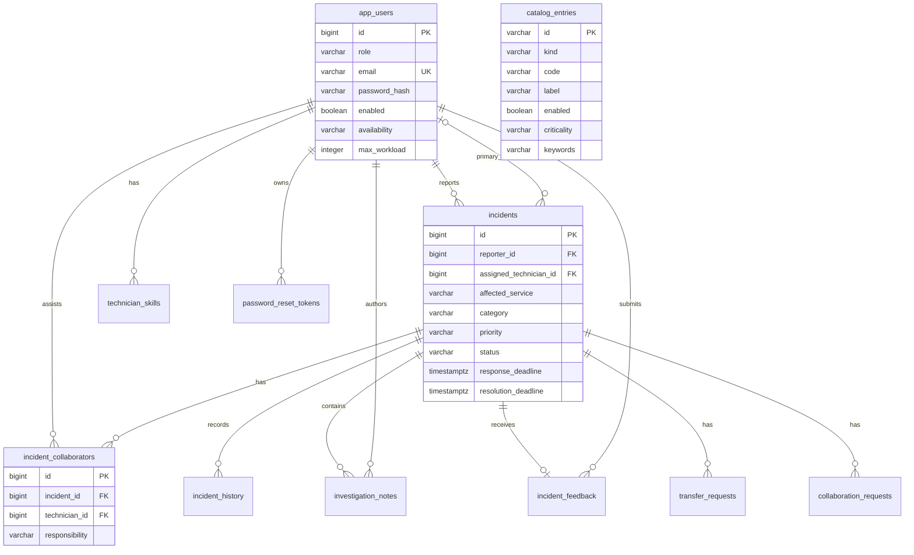

# Database

PostgreSQL is the system of record. Hibernate validates the schema; Flyway owns evolution. All V1–V19 migration files are retained unchanged. The export includes migration checksums and sequence values.

| Area | Tables |
|---|---|
| Accounts | `app_users`, `technician_skills`, `password_reset_tokens` |
| Catalog | `catalog_entries`, `problem_templates` |
| Configuration | `classification_settings`, `priority_settings`, `assignment_settings`, `sla_policies` |
| Incident and team | `incidents`, `incident_collaborators`, `transfer_requests`, `collaboration_requests` |
| Work records | `incident_history`, `investigation_notes`, `incident_feedback` |
| Delivery | `notification_deliveries`, `incident_message_reads` |
| Audit/monitoring | `audit_events`, `scheduled_events` |
| Schema version | `flyway_schema_history` |

User subclasses share `app_users` with a role discriminator. Incidents reference a reporter and optionally a primary technician; collaborators form a separate relationship. Service/category codes are logical catalog references stored as strings, not foreign keys to catalog numeric IDs. Historical values remain readable after catalog changes.

## Migration coverage

| Versions | Changes |
|---|---|
| V1–V3 | Persistent schema, constraints/indexes and legacy SLA target capture |
| V4–V6 | Student email delivery, four priority strategies and explicit criticality |
| V7–V9 | Automatic classification, problem templates and transfer requests |
| V10–V12 | Resolution candidate index, reported context and service description |
| V13–V16 | Dynamic service compatibility, reported service, message receipts and dynamic category/skill support |
| V17–V19 | Reported scope/template category, password recovery and internal staff channels |

Exact definitions are in `backend/src/main/resources/db/migration`. Do not edit applied migration files or run repair to bypass checksum failures.

## Submission data

`bits-itsm/database/submission-demo.sql` contains schema, constraints, indexes, sequences, settings and anonymized sample records. Restore into a new empty database as described in the root README. `submission-demo.sha256` records the export checksum; Git attributes preserve its line endings.

The export contains 23 demonstration accounts and 46 incidents. Names/emails, original password hashes and free-text narratives were replaced in an isolated clone. Chats, reset tokens and notification rows were removed. The original database was not modified. Shared demo credentials are for local evaluation only.

Dates and SLA snapshots remain historical November 2026 data. Background monitoring may emit overdue events on later startup. This export is not a production backup and cannot recover original personal data.

## Test isolation

Use the separate `bitsolve_restore_verify_chat_submission` database for the focused suite in the README. Other opt-in suites can truncate their test tables or create disposable databases. Never point tests at the live application database. Skipped tests are not passing tests.

## Keys and relationships

Selected core relationships only. Transfer/collaboration records also reference requesting, proposed and reviewing users. `catalog_entries` is intentionally separate: incident service/category codes are logical references, not physical foreign keys to its ID. Configuration, notification, read-receipt, audit, scheduled-event and Flyway tables are described in [Database](DATABASE.md); not every stored identifier is a foreign key.

app_users uses a numeric primary key and unique email. SINGLE_TABLE inheritance stores student, technician and administrator identities together. technician_skills is a unique technician/skill collection. incidents uses a numeric key; reporter and primary-technician references point to app_users. History, investigation notes, feedback, team membership and requests reference incidents. incident_feedback is associated with one incident; collaborator membership is distinct from primary assignment.

catalog_entries uses a string identity formed from kind and code, such as SERVICE:CAMPUS_WIFI. Service/category strings on historical incidents are logical identifiers, not foreign keys to numeric catalog rows. Dynamic codes are validated in application value types. Deactivation therefore does not erase historical names/codes. Configuration tables store the selected models and parameters; SLA policies use priority keys.

notification_deliveries stores recipient delivery state; message text is represented by investigation notes with channel/kind semantics. incident_message_reads stores per-user channel cursors. password_reset_tokens stores digests and expiry/consumption state, never the plaintext reset code. scheduled_events persists deduplication claims; audit_events records actions independently of incident display history.

## Constraints and indexes

Migrations define non-null/foreign-key/check constraints, account-email uniqueness, technician skill uniqueness and indexed incident lookups. V10 adds candidate lookup support for resolution suggestions. V13 and V16 relax only the former fixed service/category/skill representations to support dynamic codes; they do not imply that arbitrary invalid API input is accepted. V19 separates internal message channels/read positions. Consult the exact SQL rather than manually recreating this schema from the diagram.

| Migration | Source (authoritative change definition) |
|---|---|
| V1 | [V1__persistent_campus_support.sql](../bits-itsm/backend/src/main/resources/db/migration/V1__persistent_campus_support.sql) |
| V2 | [V2__integrity_and_lookup_indexes.sql](../bits-itsm/backend/src/main/resources/db/migration/V2__integrity_and_lookup_indexes.sql) |
| V3 | [V3__capture_legacy_sla_targets.sql](../bits-itsm/backend/src/main/resources/db/migration/V3__capture_legacy_sla_targets.sql) |
| V4 | [V4__student_email_delivery.sql](../bits-itsm/backend/src/main/resources/db/migration/V4__student_email_delivery.sql) |
| V5 | [V5__four_priority_strategies.sql](../bits-itsm/backend/src/main/resources/db/migration/V5__four_priority_strategies.sql) |
| V6 | [V6__explicit_service_criticality.sql](../bits-itsm/backend/src/main/resources/db/migration/V6__explicit_service_criticality.sql) |
| V7 | [V7__automatic_classification.sql](../bits-itsm/backend/src/main/resources/db/migration/V7__automatic_classification.sql) |
| V8 | [V8__campus_problem_templates.sql](../bits-itsm/backend/src/main/resources/db/migration/V8__campus_problem_templates.sql) |
| V9 | [V9__technician_transfer_requests.sql](../bits-itsm/backend/src/main/resources/db/migration/V9__technician_transfer_requests.sql) |
| V10 | [V10__resolution_recommendation_candidates.sql](../bits-itsm/backend/src/main/resources/db/migration/V10__resolution_recommendation_candidates.sql) |
| V11 | [V11__reported_incident_context.sql](../bits-itsm/backend/src/main/resources/db/migration/V11__reported_incident_context.sql) |
| V12 | [V12__catalog_service_description.sql](../bits-itsm/backend/src/main/resources/db/migration/V12__catalog_service_description.sql) |
| V13 | [V13__dynamic_incident_service_codes.sql](../bits-itsm/backend/src/main/resources/db/migration/V13__dynamic_incident_service_codes.sql) |
| V14 | [V14__reported_service_hint.sql](../bits-itsm/backend/src/main/resources/db/migration/V14__reported_service_hint.sql) |
| V15 | [V15__incident_message_receipts.sql](../bits-itsm/backend/src/main/resources/db/migration/V15__incident_message_receipts.sql) |
| V16 | [V16__dynamic_categories_and_skills.sql](../bits-itsm/backend/src/main/resources/db/migration/V16__dynamic_categories_and_skills.sql) |
| V17 | [V17__reported_scope_and_template_category.sql](../bits-itsm/backend/src/main/resources/db/migration/V17__reported_scope_and_template_category.sql) |
| V18 | [V18__password_recovery.sql](../bits-itsm/backend/src/main/resources/db/migration/V18__password_recovery.sql) |
| V19 | [V19__internal_staff_message_channels.sql](../bits-itsm/backend/src/main/resources/db/migration/V19__internal_staff_message_channels.sql) |

## Transactions and consistency

Incident services and management mutations use Spring transactions. JPA dirty checking persists validated entity changes; flushes expose integrity errors before success responses. Assignment-sensitive paths use locks on settings/incident rows so concurrent allocations re-evaluate workload. Scheduled-event claims avoid repeated durable notifications for the same monitor event. Password reset consumption is atomic so one token cannot be successfully reused.

Observer exceptions propagate to transaction callers. The email worker sends from committed outbox entries; external SMTP success cannot be undone by a database rollback. This boundary is a reason not to claim universal exactly-once delivery.

## Initialization and restoration

Flyway creates/updates an empty database; Hibernate uses ddl-auto=validate, not create/update. DemoUserSeeder is controlled separately and disabled under prod. An empty installation requires an authorized initial administrator provisioning process; do not assume public registration creates administrators. For the reproducible university demonstration use the supplied anonymized restore, not an unconfigured empty catalog.

Run the README restore once into a **new empty database** with ON_ERROR_STOP. A failed restore should be investigated before startup; do not repair history or overwrite applied migrations. The export includes sequence values. Verify its SHA-256 before restoring and let normal startup validate Flyway checksums. No application migration or live record was changed by the documentation overhaul.
