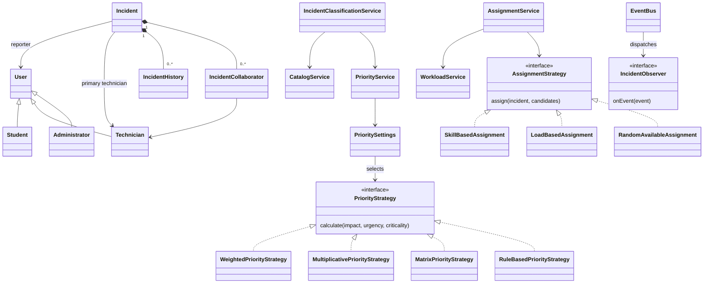

# Java object-oriented design

This guide relates OOP terminology to source that is compiled in this submission. Paths below are relative links to exact classes. Framework annotations support the design but do not, by themselves, prove a design pattern.

## Classes, objects and encapsulation

A class defines state and operations; an object is a runtime instance. [Incident.java](../bits-itsm/backend/src/main/java/com/bits/itsm/incident/Incident.java) represents one persisted support report. Its status, owner, SLA snapshots, notes and history evolve through guarded methods instead of arbitrary controller writes. [Technician.java](../bits-itsm/backend/src/main/java/com/bits/itsm/user/Technician.java) owns availability, skills and capacity. Returning a copy of skills prevents callers from bypassing configuration validation.

```java
public Set<TechnicianSkill> getSkills() { return Set.copyOf(skills); }
    public Availability getAvailability() { return availability; }
    public int getMaxWorkload() { return maxWorkload; }
    public boolean isAvailable() { return availability == Availability.AVAILABLE; }
    public void setAvailable(boolean available) { availability = available ? Availability.AVAILABLE : Availability.UNAVAILABLE; }
    public void setAvailability(Availability availability) {
        if (availability == null) throw new IllegalArgumentException("Availability cannot be null.");
        this.availability = availability;
    }
    public boolean canReceive(long workload) { return isEnabled() && isAvailable() && workload < maxWorkload; }
```

This keeps the assignment rule in one domain object. A component displaying AVAILABLE cannot override canReceive: enabled state and capacity remain necessary. Encapsulation reduces inconsistent checks across controller paths.

## Inheritance and overriding

Inheritance specializes a common type. [User.java](../bits-itsm/backend/src/main/java/com/bits/itsm/user/User.java) holds shared identity and credentials. [Student.java](../bits-itsm/backend/src/main/java/com/bits/itsm/user/Student.java), [Technician.java](../bits-itsm/backend/src/main/java/com/bits/itsm/user/Technician.java) and [Administrator.java](../bits-itsm/backend/src/main/java/com/bits/itsm/user/Administrator.java) extend it. JPA SINGLE_TABLE inheritance persists them using a role discriminator, not three disconnected account tables.

```java
@Override
    public Role getRole() { return Role.TECHNICIAN; }
```

The override supplies the technician role through the shared User API. Role-sensitive behavior still includes explicit authorization checks: inheritance is a domain model, not a security boundary. Shared identity behavior avoids repeating account storage; adding a new role would still require coordinated security/UI changes.

## Abstraction, interfaces and polymorphism

Abstraction exposes the operation a caller needs while hiding the implementation. An interface specifies that contract. Polymorphism allows different implementations to be invoked through the same reference.
[PriorityStrategy.java](../bits-itsm/backend/src/main/java/com/bits/itsm/priority/PriorityStrategy.java)

```java
public interface PriorityStrategy {
    Priority calculate(Level impact, Level urgency, Level criticality);
}
```

The interface excerpt omits its nested Thresholds record. WeightedPriorityStrategy, MultiplicativePriorityStrategy, MatrixPriorityStrategy and RuleBasedPriorityStrategy implement calculate. PriorityService uses the selected implementation without duplicating each formula in incident creation. This is runtime policy variation, not method overloading.

## Strategy pattern: priority

The Strategy pattern encapsulates interchangeable algorithms. [PriorityController.java](../bits-itsm/backend/src/main/java/com/bits/itsm/priority/PriorityController.java) validates a Configuration, preserves omitted optional settings through complete(), and calculator() constructs the selected strategy. [PriorityService.java](../bits-itsm/backend/src/main/java/com/bits/itsm/priority/PriorityService.java) obtains catalog criticality and invokes the resulting calculator.

```java
@Override public Priority calculate(Level impact, Level urgency, Level criticality) {
        double score = 50 * (impactWeight * impact.ordinal() + urgencyWeight * urgency.ordinal() + criticalityWeight * criticality.ordinal());
        return thresholds.priority(score);
    }
```

The weighted implementation uses three ordinal inputs and validated weights/thresholds. Other implementations keep their own formulas. This separates policy tuning from lifecycle transitions. The selected export mode is MATRIX, so demonstrating weighted code does not mean every saved incident used weighted calculation.

## Strategy pattern: assignment

[AssignmentStrategy.java](../bits-itsm/backend/src/main/java/com/bits/itsm/assignment/AssignmentStrategy.java) defines selection over Candidate values. [SkillBasedAssignment.java](../bits-itsm/backend/src/main/java/com/bits/itsm/assignment/SkillBasedAssignment.java), [LoadBasedAssignment.java](../bits-itsm/backend/src/main/java/com/bits/itsm/assignment/LoadBasedAssignment.java) and [RandomAvailableAssignment.java](../bits-itsm/backend/src/main/java/com/bits/itsm/assignment/RandomAvailableAssignment.java) implement it. AssignmentService builds eligible candidates first; strategies rank/select that set. This separation matters: choosing load-based must not bypass skill, enabled status or capacity.

Skill-based ranks preferred skill and weighted workload; load-based ranks weighted workload. General-support fallback uses random selection among eligible available technicians without specialist matching. Adding another ranker is localized, but exposing a new saved strategy still requires configuration validation and UI support. The design is extensible, not magically configuration-free.

## Composition and dependency injection

Composition builds behavior by holding collaborating objects. [EventBus.java](../bits-itsm/backend/src/main/java/com/bits/itsm/event/EventBus.java) holds observers; [IncidentService.java](../bits-itsm/backend/src/main/java/com/bits/itsm/incident/IncidentService.java) combines repositories, classification, priority and assignment services. Constructor injection supplies these collaborators explicitly, allowing tests to provide controlled implementations without constructing the entire application.

```java
private final List<IncidentObserver> observers;

    public EventBus(List<IncidentObserver> observers) {
        this.observers = List.copyOf(observers);
    }
```

The defensive copy prevents later mutation of the injected observer collection. Spring discovers beans and wires the constructor; the object remains ordinary Java with explicit dependencies. Composition avoids a large inheritance hierarchy for every workflow variation.

## Observer pattern and event handling

An observer subscribes to events emitted by another object. [IncidentObserver.java](../bits-itsm/backend/src/main/java/com/bits/itsm/event/IncidentObserver.java) and [IncidentEvent.java](../bits-itsm/backend/src/main/java/com/bits/itsm/event/IncidentEvent.java) define the event contract. EventBus calls registered observers; audit and notification components respond without placing their full implementation in each lifecycle action.

```java
public void publish(IncidentEvent event) {
        RuntimeException failure = null;
        for (IncidentObserver observer : observers) {
            try {
                observer.onEvent(event);
            } catch (RuntimeException ex) {
                failure = ex;
                log.error("Observer {} failed on {}", observer.getClass().getSimpleName(), event.type(), ex);
            }
        }
        if (failure != null) throw failure;
    }
```

Dispatch is synchronous and failures are rethrown after all observers are attempted. Under a surrounding transaction, persistence can roll back. This gives consistent local side effects, but does not provide a durable asynchronous event bus. EmailChannel separately writes an outbox for later sending.

## Factories, repositories and DTOs

[NotificationFactory.java](../bits-itsm/backend/src/main/java/com/bits/itsm/notification/NotificationFactory.java) centralizes conversion of incident events to notification objects. It is a simple factory, not an Abstract Factory family. [IncidentRepository.java](../bits-itsm/backend/src/main/java/com/bits/itsm/incident/IncidentRepository.java) and [UserRepository.java](../bits-itsm/backend/src/main/java/com/bits/itsm/user/UserRepository.java) isolate query declarations from use-case orchestration using Spring Data. Repository abstraction does not hide the fact that persistence is PostgreSQL/JPA.

DTO records in [IncidentData.java](../bits-itsm/backend/src/main/java/com/bits/itsm/incident/IncidentData.java) define request validation and response shape. They prevent returning password hashes through incident APIs and separate reported context from effective classification. Records are immutable carriers; the Incident entity remains mutable through validated transitions.

```java
public record PriorityOverride(@NotNull Priority priority,@NotBlank @Size(min=5,max=2000) String reason) { }
```


## Value objects versus enums

[ServiceCode.java](../bits-itsm/backend/src/main/java/com/bits/itsm/incident/ServiceCode.java), Incident.ItService, Incident.Category and [TechnicianSkill.java](../bits-itsm/backend/src/main/java/com/bits/itsm/user/TechnicianSkill.java) represent validated string-backed identifiers. Their valueOf helpers do not make them Java enums. This permits an administrator-created service to pass through classification and persistence without adding a Java enum constant. Fixed lifecycle status, priority and availability remain enums because their behavior is explicitly finite.

## SOLID: evidence and boundaries

| Principle | Actual example | Practical limit |
|---|---|---|
| Single responsibility | Priority calculators own formulas; EventBus dispatches | IncidentService still orchestrates many related operations |
| Open/closed | New IncidentObserver bean participates without editing dispatch | New product workflows still need endpoints and permission checks |
| Liskov substitution | Student/Technician/Administrator share the User identity contract | Role-specific operations must not be called on arbitrary users |
| Interface segregation | PriorityStrategy and AssignmentStrategy expose narrow policy operations | They are not a general-purpose service framework |
| Dependency inversion | Services receive repository/policy collaborators, observers depend on event contracts | Some services deliberately depend on concrete domain services |



Selected design relationships. Service dependencies are not database tables. Dynamic catalog code value objects and transport DTOs are omitted for readability; see [OOP design](OOP_DESIGN.md).


The diagram is a selected class view, not every field or framework type. These patterns reduce repeated policy code and make focused tests possible; they do not prove perfect adherence to every SOLID principle. See [testing](TESTING.md) for evidence and [workflows](WORKFLOWS.md) for runtime behavior.
