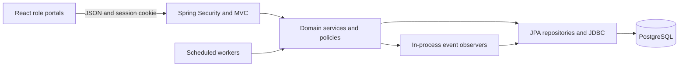
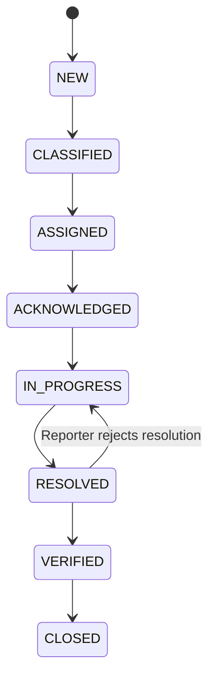

# BITSolve — Academic Project Report

## BITSolve: Campus IT Service Management

**CS F213 — Object Oriented Programming**
**Group 39 · BITS Pilani, Hyderabad Campus · First Semester 2026–27**

| Student | ID |
|---|---|
| Aditya Gupta | 2025A7PS0923H |
| Lakshya Goyal | 2025A7PS0120H |
| Aditya Dash | 2025ADPS0218H |
| Kush Gupta | 2025A7IS2420H |

### Abstract

BITSolve implements a campus IT support workflow using Java, Spring Boot, React and PostgreSQL. A student reports a problem in ordinary language; the backend attempts catalog-based classification, calculates priority using an administrator-selected model, captures service-level targets and assigns an eligible technician. Cases with insufficient evidence or configuration remain visible as exceptions instead of receiving arbitrary decisions.

The project combines this automation with investigation notes, student conversation, private staff coordination, collaboration and transfer requests, resolution verification, feedback, notifications and audit history. Java domain objects guard lifecycle transitions, strategy interfaces separate interchangeable algorithms, and observer-based event handling connects operational actions with notifications and auditing. Persistent configuration allows services and policies to evolve without hardcoding every campus service in Java.

This report describes the submitted implementation, including its limitations. It distinguishes authenticated application features from development previews and historical test evidence from checks performed during the final documentation pass. The anonymized database export supports local evaluation without distributing original credentials or private conversations.

**Report layout:** 25 planned pages with explicit page breaks. Use A4, 11-point body text and approximately 20 mm margins; check pagination after conversion. This concise report does not replace the separately prepared 48-page local report. The linked technical guides contain complete API contracts and migration details.

<!-- Planned page 1 of 25 -->

<div style="break-after: page; page-break-after: always;"></div>

## 1. Problem statement and objectives

Campus support often receives incomplete reports through unrelated channels. A message may describe a symptom without identifying a service, while a technician needs scope, urgency and ownership before investigation can begin. Without a common record, a student cannot reliably track progress and administrators cannot distinguish an unresolved report from a completed one.

BITSolve addresses this problem by keeping the report, classification evidence, owner, deadlines, communication and outcome together. The student interface captures useful context without allowing the reporter to choose the final priority. The technician interface concentrates on assigned work and investigation. Administrator interfaces maintain the service catalog and policies and resolve genuine exceptions.

The principal objectives are to automate routine processing, make assignments respect skills and capacity, preserve accountable overrides and provide a verifiable resolution workflow. Automation is an attempt, not a promise that any description can be understood. Missing evidence, ambiguous services and unavailable technicians have different causes and therefore different visible outcomes.

The project is an academic implementation of a campus service desk. It does not claim production availability certification, a measured reduction in support time or machine-learning understanding of natural language. Its practical contribution is an integrated, configurable workflow whose decisions can be inspected in source and persisted records.

Successful operation means more than a completed form: the backend must validate the caller, persist the incident, attempt the policy pipeline and return the resulting state. The same stored record then drives the student, technician and administrator views.

<!-- Planned page 2 of 25 -->

<div style="break-after: page; page-break-after: always;"></div>

## 2. Requirements and implementation scope

Functional requirements cover three roles. Students register with the institutional email format, report problems, view their own incidents, communicate with support and assess proposed resolutions. Technicians manage availability, start assigned work, record investigation, request assistance and provide resolutions. Administrators manage accounts, catalog entries, rules, assignment profiles and SLA policies; they also inspect exceptions and perform audited interventions.

Non-functional requirements include persistent state, role and participant authorization, validated input, a reproducible database restore and readable failure states. The frontend must distinguish loading, empty and failed responses. A successful save is reported only after a backend response. Sensitive credentials are excluded from ordinary DTOs and repository artifacts.

| Requirement | Implementation boundary |
|---|---|
| Routine automation without approval | IncidentService invokes classification, priority/SLA and assignment during creation |
| Configurable campus services | PostgreSQL catalog entries and dynamic service identifiers |
| Restricted staff coordination | Incident membership and server-side channel checks |
| Monitoring without a user session | Scheduled backend workers |
| Historical accountability | Incident history, audit events and captured targets |

The technology baseline is Java 25, Spring Boot 4.1.2, React 19.3, Vite 8.3 and PostgreSQL 18. Maven and npm lockfiles/wrappers support reproducibility. The project does not include a separate mobile application, external message broker or WebSocket transport. Optional SMTP delivery requires private environment configuration and remains outside the verified demonstration boundary.

<!-- Planned page 3 of 25 -->

<div style="break-after: page; page-break-after: always;"></div>

## 3. System architecture

BITSolve follows a three-tier arrangement. React implements presentation and interaction. A Spring Boot application exposes JSON APIs, authenticates sessions and coordinates domain services. PostgreSQL stores accounts, incidents, configuration and operational history. These layers are deployed as a modular monolith rather than separate business microservices.



The browser is not trusted to enforce business rules. It can hide unavailable actions and validate fields for usability, but the API resolves the current user and checks role, ownership and incident state again. Service methods provide transaction boundaries around related changes. Entity methods protect state transitions, while repositories provide persistence and locking operations.

In development, Vite proxies API requests to the backend. In a packaged build, Maven includes the frontend distribution in the executable JAR, allowing the application and API to share an origin. The Docker image reproduces the build sequence but expects PostgreSQL separately. Detailed diagrams and source links are maintained in [architecture.md](architecture.md).

<!-- Planned page 4 of 25 -->

<div style="break-after: page; page-break-after: always;"></div>

## 4. Domain and request design

The central domain object is Incident. It stores the reporter, title, description, reported context, effective classification, priority, status, primary technician and captured SLA information. Associated histories, notes, feedback and collaborators preserve the work performed around the incident. User specializations share account identity while technician-specific state describes availability, skills and workload limits.

Controllers accept request records such as IncidentData.Create and return IncidentData.View. This separates the public contract from persistence objects. A student view filters information that is only appropriate for staff. Authentication is resolved from the session rather than accepted as a caller-supplied actor identifier.

For a creation request, the controller validates basic shape and text lengths. IncidentService checks that the caller is a student, constructs the report and attempts automatic processing. Classification and assignment services use persisted settings and catalog data. Events record relevant side effects before the response reflects the resulting state.

This division keeps HTTP concerns out of most domain methods. It also makes failures explicit: invalid input is different from a forbidden operation, a conflicting lifecycle transition or an incident awaiting eligible allocation. The frontend should not collapse all these outcomes into “successfully assigned.” The API reference documents exact DTO declarations and permission boundaries rather than treating endpoint names as complete specifications.

<!-- Planned page 5 of 25 -->

<div style="break-after: page; page-break-after: always;"></div>

## 5. Frontend implementation: application shell

The frontend is mounted by main.jsx and organized through App.jsx. The shell owns the authenticated account and role-specific page selection. Shared navigation, profile information and a notification shortcut provide consistent access across student, technician and administrator portals. The implementation uses React and Vite; it does not rely on a claimed Next.js or React Router architecture.

Reusable components include modal dialogs, badges, page headers, empty states, statistics and toast messages. Feature stylesheets supplement the common typography and color system. Native controls and explicit labels retain familiar form interaction. Tables use intentional horizontal overflow when their columns cannot fit, protecting deadline and date readability.

The application has both live authenticated components and development preview data. Preview content is explicitly fictional and must not be used as proof of persistence. The demoData module remains in the repository because it supports these imported preview routes; it is not disposable documentation clutter.

The final documentation pass changes none of these components. Existing browser screenshots from the verified isolated demonstration can be inserted when preparing a visual presentation; this report does not fabricate or relabel preview screenshots as live records. Source entry points and page responsibilities appear in [FRONTEND.md](FRONTEND.md).

<!-- Planned page 6 of 25 -->

<div style="break-after: page; page-break-after: always;"></div>

## 6. Frontend implementation: student dashboard

The student dashboard focuses on the student's support requests rather than campus operational management. It presents open requests, resolutions ready for review and recent activity, with a clear route to report a new problem. A student is not expected to manage classification queues, technician capacity or priority distributions.

OperationsDashboard loads role-appropriate endpoints. For students it requests the student's incident list, notifications and available options. Promise.allSettled allows a section to report its own loading failure rather than replacing an API error with an apparently empty dataset. Summary values are derived from the returned records, not mock constants.

Recent requests link to their incident details. A resolution awaiting confirmation receives a focused prompt so that the student can verify whether the fix worked. The design therefore connects the dashboard to the next meaningful action instead of presenting every available administrator statistic.

The dashboard refreshes visible data periodically, while explicit navigation and refresh actions retrieve current records. This supports up-to-date display but is not WebSocket server push. Counts are scoped by backend authorization. Historical demonstration incidents remain dated in November 2026 and should be interpreted as sample records, not current production usage.

The frontend source also retains administrative and technician dashboard branches. Their larger operational datasets do not imply that students can access those protected endpoints.

<!-- Planned page 7 of 25 -->

<div style="break-after: page; page-break-after: always;"></div>

## 7. Frontend implementation: incident reporting

ReportIncident collects a short title, detailed description, category and optional service, urgency and affected-user context. Common campus templates assist entry while allowing the author to retain or edit their description. The selected service or urgency is reported evidence, not an instruction to bypass the backend's model.

The form loads actual enabled options and template mappings. Disabled or unconfigured service hints are not silently invented. Client-side validation helps users correct missing text, but the create DTO also requires a nonblank title of at most 100 characters and a description between 20 and 2000 characters. Required category and positive affected-user estimates are validated server-side.

After submission, the returned incident can be assigned, classified but waiting for a technician, or marked for review. The UI must display that actual outcome. A report containing familiar words can still need review if configuration is absent, evidence conflicts or services tie. Explaining this distinction is more accurate than promising that a template always guarantees assignment.

The reporting helpers have focused Node tests for template preservation, supported category mappings and urgency hints. These tests verify pure logic; they do not replace a browser submission test. The isolated PostgreSQL suite exercises persistence and automatic processing without writing test incidents to the original database.

<!-- Planned page 8 of 25 -->

<div style="break-after: page; page-break-after: always;"></div>

## 8. Frontend implementation: technician workspace

The technician portal presents work assigned to the current technician and incident-team participation. Availability is persisted as AVAILABLE, BUSY or UNAVAILABLE. AVAILABLE permits consideration for new automatic work, but does not override enabled status, skill requirements or capacity. Existing assignments remain attached when availability changes.

The header and preference controls consume backend availability rather than maintaining independent display-only values. After a successful update, the shared UI state changes; failed saves display an error. Administrator workload views retrieve the same persisted state. The synchronization behavior has a focused isolated persistence test.

Incident details expose Start Work, notes, information requests and resolution actions where the current role and state permit them. Start Work can acknowledge an assigned incident and begin investigation atomically. Collaborators can contribute authorized work without acquiring all primary-owner lifecycle powers.

Transfer requests describe why ownership should move and preserve handover information. Collaboration requests identify a supporting technician and responsibility. Reviewed decisions can be seen in the existing team/request interfaces. Neither changing availability nor requesting a collaborator silently transfers the primary assignment.

This workspace combines record inspection with concrete next actions. It avoids a purely visual demo of buttons: persisted operations call the same secured backend services used by other incident interfaces.

<!-- Planned page 9 of 25 -->

<div style="break-after: page; page-break-after: always;"></div>

## 9. Frontend implementation: administration

Administrators use All Incidents to inspect reports across campus. Filters, sorting, deadline display and detail navigation help narrow the operational list. Management dialogs support assignment, priority override, manual escalation, transfer review, collaborators and audit inspection. Reasons are required where an intervention changes accountable decisions.

IT Services provides real catalog creation and editing. A service includes code, name, description, classification keywords, criticality and enabled state. Activation requires valid criticality. The service list refreshes after confirmed persistence, and Classification Review obtains its available services from the actual enabled catalog rather than a fixed frontend enum.

Priority Configuration is located with Assignment Strategies. The administrator can inspect and preview supported models before saving. SLA Policies sets response and resolution targets for future captured policies. These controls do not imply that an old incident's deadline should reset when a setting changes.

User and technician management handle enabled state, skills and workload limits. The backend prevents unsafe operations such as self-disabling the current administrator or disabling a technician who still owns unresolved incidents without reassignment. The UI is a convenience layer around these rules, not their sole implementation.

The report does not claim every administrator screen received a complete accessibility or browser regression audit. API and persistence evidence should be distinguished from full interactive coverage.

<!-- Planned page 10 of 25 -->

<div style="break-after: page; page-break-after: always;"></div>

## 10. Frontend implementation: communication and API state

IncidentConversation separates reporter-visible conversation from internal staff chat. Internal chat is limited to administrators, the primary technician and approved collaborators for that incident. It is not a room shared with all campus staff. Urgent staff instructions are restricted to administrators. Read cursors are persisted independently for each channel.

Notifications are recipient-specific, with read/unread state and incident navigation. The profile shortcut retrieves unread counts periodically. Conversation and dashboard refresh also use polling. Describing these features as instant server-push delivery would misrepresent their transport and timing.

api.js centralizes JSON fetches, includes session credentials and obtains the CSRF token before mutations. It dispatches session-expiration state for protected 401 responses. Requests have a timeout; for a timed-out mutation, the UI warns that saving may already have completed and recommends checking records before submitting again. This avoids presenting a network timeout as proof that no write occurred.

Expected validation messages are surfaced, while certain server/malformed responses use a generic connection error. Loading, empty and error states are distinct. The browser does not automatically retry writes or fabricate a successful message on click.

Password Settings supports changing a known password and using an administrator-issued reset code. The login help dialog explains that process rather than pretending to send a recovery email that is not implemented.

<!-- Planned page 11 of 25 -->

<div style="break-after: page; page-break-after: always;"></div>

## 11. Backend implementation: classification

IncidentClassificationService reads enabled catalog services with valid business criticality. Matching combines title and description, normalizes Unicode and Wi-Fi spelling variants, and evaluates distinct configured keywords with boundaries. A uniquely highest-scoring service can be selected. Tied candidates remain ambiguous instead of being resolved by incidental database order.

Service identifiers are string-backed value types, so a newly configured code can pass through the pipeline without adding a Java enum constant. Built-in services continue to use familiar codes. Disabled services and services without valid criticality are excluded. The catalog is therefore part of operational configuration, not a decorative UI list.

Impact and urgency require separate evidence. Administrator rules supply recognizable scope and time-pressure terms. Missing or conflicting evidence can still require review even after the service is recognized. The combined hostel LAN/Wi-Fi template has a narrow description-based disambiguation path for campus Wi-Fi versus network service.

For eligible Other reports, the configured OTHER service and default impact/urgency provide a general-support fallback. Choosing Other is not, by itself, a requirement for administrator approval. The fallback still depends on valid enabled configuration.

This is deterministic matching, not semantic machine learning. Broadening aliases improves coverage but cannot guarantee arbitrary-language classification. The recorded explanation and review flag make that limitation visible to administrators and reporters.

<!-- Planned page 12 of 25 -->

<div style="break-after: page; page-break-after: always;"></div>

## 12. Backend implementation: priority and SLA capture

PriorityService uses the administrator-selected strategy: Weighted, Multiplicative, Matrix or Rule-based. The same impact, urgency and service criticality inputs enter different policy implementations through PriorityStrategy. Strategy selection is persistent and is not chosen by the student at submission time.

The weighted model uses LOW/MEDIUM/HIGH ordinal values 0/1/2 and computes 50 times the weighted sum. Weights must be nonnegative and sum to one; configured descending thresholds map the score to P1–P4. Matrix mode uses the impact/urgency grid with criticality adjustment. Rule-based mode evaluates configured rules and fallback. The submitted export selects MATRIX.

| Priority | Saved response target | Saved resolution target |
|---|---:|---:|
| P1 | 5 minutes | 30 minutes |
| P2 | 15 minutes | 130 minutes |
| P3 | 60 minutes | 500 minutes |
| P4 | 240 minutes | 1450 minutes |

These are the export's saved settings, not universal defaults. SLA targets and deadlines are captured for incidents. Later policy changes do not silently recalculate all historical deadlines, and priority override preserves existing deadlines with an audit reason.

The visible countdown is the time to a captured target. It is not a prediction of repair completion. A separate historical estimate requires enough comparable successful records and remains explicitly advisory.

<!-- Planned page 13 of 25 -->

<div style="break-after: page; page-break-after: always;"></div>

## 13. Backend implementation: technician allocation

AssignmentService builds an eligible candidate set before invoking a ranking strategy. A technician must be enabled, AVAILABLE and below capacity. Known categories additionally require the configured skill. The skill-based model ranks skill preference and weighted workload; the load-based model emphasizes weighted workload while retaining eligibility checks. Stable ID tie-breaking prevents database enumeration from becoming an undocumented rule.

General-support fallback uses random selection among enabled AVAILABLE technicians with spare capacity and does not require specialist matching. This supports routine Other incidents without forcing administrator approval. Random choice does not imply equal allocation over a small number of reports.

The backend attempts allocation during incident creation after successful classification and priority/SLA processing. If there is no eligible technician, the report remains visible with its calculated policy and pending allocation. A scheduled retry can try again later. Classification failure and assignment failure are therefore different states with different corrective actions.

Assignment-sensitive updates use locks and workload checks to reduce conflicting concurrent allocations. Manual assignment, transfers and collaboration still validate the destination. Administrator override is not permission to create an invalid team.

Changing a technician to BUSY or UNAVAILABLE excludes them from new automatic assignments but does not erase existing ownership. Reassignment is an explicit supported workflow with history. This distinction is necessary to prevent a profile preference from silently moving live work.

<!-- Planned page 14 of 25 -->

<div style="break-after: page; page-break-after: always;"></div>

## 14. Backend implementation: lifecycle and team operations

Incident transitions retain a clear distinction between reporting, assignment, work, resolution and confirmation. The ordinary path is NEW → CLASSIFIED → ASSIGNED → ACKNOWLEDGED → IN_PROGRESS → RESOLVED → VERIFIED → CLOSED. Review and pending allocation are flags/conditions, not extra invented status constants.



The service's Start Work operation can perform acknowledgment and start together. A request for information sets an awaiting-student condition without introducing a waiting status or pausing SLA. Resolution rejection returns to investigation and clears current resolution fields while retaining history.

Transfer approval changes the primary technician after revalidation. Collaboration adds support responsibility without changing ownership. Administrators can make audited team changes, override priority or close an invalid/duplicate report. Student withdrawal is limited to an eligible new incident; it is not account deletion.

Normal verification and feedback connect completion to the reporter's experience. Invalid, duplicate or withdrawn closures retain records but must not be described as successful resolutions in operational interpretation.

<!-- Planned page 15 of 25 -->

<div style="break-after: page; page-break-after: always;"></div>

## 15. Backend implementation: events and monitoring

EventBus dispatches IncidentEvent objects to injected IncidentObserver implementations. It invokes observers synchronously, attempts all observers and then propagates a captured failure. With an enclosing transaction, related database changes can roll back. This is local event-driven organization, not an external broker or a universally durable asynchronous stream.

Audit observers preserve actions and notification handling stores recipient deliveries. EmailChannel writes selected student events to a persistent outbox; a scheduled worker sends committed entries and retries failures. External SMTP success cannot be rolled back with a database transaction, and actual mailbox delivery was not tested for submission.

SlaMonitor runs independently of any logged-in user. It identifies warnings at 80 percent elapsed and breaches after deadlines. Persisted scheduled-event keys prevent repeated durable claims for the same warning/escalation event across restarts.

Automatic escalation applies to unacknowledged P1 incidents beyond their response deadline, progressing through configured management levels with a default five-minute step. Those levels are operational labels, not additional authenticated roles. Manual administrator escalation is a separate reasoned action and does not silently replace the assigned technician.

Backend downtime delays monitoring, and polling delays browser visibility. These limits should be stated rather than describing the application as continuously available or instant under every deployment condition.

<!-- Planned page 16 of 25 -->

<div style="break-after: page; page-break-after: always;"></div>

## 16. OOP design: entities, inheritance and encapsulation

The object model uses classes to keep related state and behavior together. Incident represents a support report with guarded lifecycle methods. Technician encapsulates skills, availability and capacity. User holds shared account identity, while Student, Technician and Administrator specialize it through inheritance and overridden role behavior.

The following small excerpt is from Technician.java:

```java
public boolean isAvailable() {
    return availability == Availability.AVAILABLE;
}
public boolean canReceive(long workload) {
    return isEnabled() && isAvailable() && workload < maxWorkload;
}
```

Formatting is expanded for readability; the expressions are unchanged. The check illustrates why availability alone is insufficient. Encapsulation locates the combined condition in a reusable domain operation rather than repeating only part of it across screens.

Skills are returned as an immutable copy, so callers cannot directly mutate the backing collection. Configuration methods validate their input before changing state. User inheritance is mapped to a single account table with discriminator values; it does not require three unrelated credential stores.

Inheritance reduces duplication, but authorization still checks the current role and incident relationship. It would be incorrect to infer that a common User reference can perform every technician or administrator operation. Detailed source links and exact excerpts appear in [OOP_DESIGN.md](OOP_DESIGN.md).

<!-- Planned page 17 of 25 -->

<div style="break-after: page; page-break-after: always;"></div>

## 17. OOP design: abstraction and strategy

An interface defines an operation independently of a particular algorithm. PriorityStrategy exposes calculate with impact, urgency and criticality and returns a priority. Four implementations satisfy that contract. The caller can invoke the selected implementation polymorphically while keeping lifecycle code separate from each formula.

```java
Priority calculate(Level impact, Level urgency, Level criticality);
```

AssignmentStrategy similarly selects a technician from candidates. Eligibility filtering remains a separate responsibility, ensuring that swapping the ranker does not disable skill or capacity rules. The general-support random strategy intentionally receives candidates without a specialist requirement.

The Strategy pattern improves maintainability by localizing changes to a model. A threshold change can be configured; a new algorithm can be implemented behind the interface. Exposing a completely new model still requires configuration validation, persistence compatibility and UI work. The project does not claim that all future extensions require zero source changes.

Polymorphism here is method dispatch through a shared contract. It is different from overloading the same method name with different parameters. Dynamic service identifiers solve another problem: they allow catalog records to represent custom services without extending a fixed enum. These two mechanisms should not be conflated.

The design supports focused tests for formulas and rankers without requiring a browser or a fully populated campus database.

<!-- Planned page 18 of 25 -->

<div style="break-after: page; page-break-after: always;"></div>

## 18. OOP design: composition, observers and repositories

Composition assembles an object's behavior from collaborators. IncidentService receives repositories and policy services through constructor injection. EventBus receives a list of IncidentObserver implementations. This makes dependencies explicit and permits tests to substitute controlled collaborators where appropriate.

The Observer pattern separates event publication from consumers such as auditing and notifications. Adding an observer bean does not require inserting its full implementation into every incident action. However, dispatch is synchronous, so observer failure and transaction behavior remain part of the workflow's correctness.

NotificationFactory centralizes event-to-notification construction as a simple factory. It is not an Abstract Factory product family. Spring Data repository interfaces separate query declarations from application orchestration, while DTO records separate transport contracts from persistence entities.

These choices provide concrete examples of single responsibility, dependency inversion and open/closed extension. They do not prove perfect SOLID compliance: IncidentService coordinates many related operations, and some collaborators are intentionally concrete classes. The academic value lies in explaining where each abstraction helps and where it stops.

For example, a repository abstraction makes service testing easier, but PostgreSQL constraints and transactions still determine persistence correctness. An observer decouples code organization, but does not by itself supply broker durability. Accurate design documentation distinguishes these benefits from guarantees the implementation does not provide.

<!-- Planned page 19 of 25 -->

<div style="break-after: page; page-break-after: always;"></div>

## 19. Database design and migrations

PostgreSQL is the authoritative store. JPA/Hibernate maps entities and validates the schema; Flyway owns schema changes. The submission retains V1–V19 migrations and an anonymized SQL restore with sequence values and migration checksums. Historical migrations are not rewritten to match a new description.

Accounts occupy app_users with technician_skills as an associated collection. incidents references the reporter and optional primary technician. History, notes, feedback, collaborator membership and team requests reference incidents. Catalog and configuration tables store services, categories, rules, priority models, assignment strategy and SLA policies.

Notification deliveries, read cursors, audit events, scheduled-event claims and password reset digests provide supporting persistence. Messages are represented through note/channel semantics rather than an invented standalone chat server. Catalog service codes are logical string identifiers, so disabled services do not erase historical incident codes.

Foreign keys, uniqueness and checks supplement Java validation. Row locks coordinate assignment-sensitive operations. Transactions group related entity updates and events. The exact migration list and core ER diagram are maintained in [DATABASE.md](DATABASE.md).

The export contains 23 anonymized accounts and 46 incidents at packaging time. Original names, emails, hashes and free-text narratives were replaced in an isolated clone; chats, notifications and reset tokens were removed. The export is demonstration data, not a recoverable backup of original personal content.

<!-- Planned page 20 of 25 -->

<div style="break-after: page; page-break-after: always;"></div>

## 20. Testing methodology and observed evidence

Verification combines domain/service tests, frontend helper tests and opt-in PostgreSQL integration tests. Pure policy checks isolate algorithm behavior; persistence tests confirm that database-backed operations and permissions work together. No single test layer establishes every aspect of the application.

Historical submission evidence records 20 passing frontend tests, a successful Vite production build and a backend verify run with 146 passed and 71 opt-in tests skipped. A separate isolated PostgreSQL run passed 24 tests covering automatic processing, custom service setup, internal conversations and availability synchronization. Skipped tests are not included as successful database tests.

The export was restored into a second empty database. Startup validated Flyway V1–V19, served the packaged frontend and health endpoint, and supported login plus subsequent account retrieval for all three roles. These are specific smoke results, not a full browser walkthrough of every page.

The final documentation pass reruns standard frontend and backend checks and records their exact results separately in [VERIFICATION.md](VERIFICATION.md). It does not claim a new PostgreSQL run merely because historical results remain valid evidence.

Remaining gaps include external SMTP, sustained load/failover, production HTTPS/proxy operation and complete accessibility/responsive interaction coverage. No response-time benchmark, user study or production reliability metric is fabricated.

<!-- Planned page 21 of 25 -->

<div style="break-after: page; page-break-after: always;"></div>

## 21. Security and password recovery

Spring Security authenticates JSON login requests into an HTTP session. The session cookie is HTTP-only and SameSite=Lax; secure-cookie behavior is enabled by default in the production profile. Login rotates session identity and CSRF state. Mutating requests obtain a token from the backend and send the specified header.

Public registration is restricted to the institutional email format and creates students only. It does not verify mailbox ownership. Application password encoding uses BCrypt; password policy requires at least 12 characters, a letter and number, and respects the 72-byte input limit. The shared demo password belongs only to anonymized evaluation accounts.

Password recovery is administrator-initiated for an enabled account. A random reset code is returned for secure handover, its digest is stored, and expiry and consumption are enforced. A successful reset invalidates earlier credentials through account-version checks. It is not an automatically emailed “forgot password” workflow.

Authorization combines URL role restrictions with incident participation and lifecycle checks. Internal messages are hidden from students and unrelated staff at the backend boundary. Disabled accounts lose access on subsequent requests.

This design does not replace deployment security. HTTPS termination, secrets management, initial administrator provisioning, backup access and SMTP configuration remain operational responsibilities. The repository contains no live database password or private sender credential.

<!-- Planned page 22 of 25 -->

<div style="break-after: page; page-break-after: always;"></div>

## 22. Integrated features and operational interpretation

Several useful features emerge from combining the modules rather than adding isolated screens. A custom catalog entry can appear in Classification Review and keyword matching after valid activation. Automatic assignment then follows the selected policy and technician eligibility. Administrator correction continues that same pipeline instead of creating a separate incident system.

Collaboration allows multiple technicians to contribute while retaining a single accountable primary owner. Student conversation and staff coordination share an incident context but maintain separate access and read state. Notifications link recipients back to the relevant record and persist acknowledgment.

Similarity detection suggests related open incidents using bounded text/category/service criteria. It does not merge or delete reports. Historical resolution estimation requires a sufficient comparable sample and returns a rounded median, not a guaranteed repair time. SLA targets remain separately defined by priority policy.

Operational dashboards aggregate authorized records, workloads, catalog status and request queues. Student views emphasize their own support progress. Feedback averages describe the available records; demo satisfaction data is not a production survey. Historical dates affect graphs and deadlines naturally as time advances.

Manual escalation and automated monitoring improve visibility, but they do not mean an escalation automatically reassigns a technician or creates new authenticated management roles. These distinctions make the demonstration more credible and help future maintainers avoid building UI assumptions that conflict with backend behavior.

<!-- Planned page 23 of 25 -->

<div style="break-after: page; page-break-after: always;"></div>

## 23. Deployment, limitations and future work

For evaluation, restore submission-demo.sql into a new empty PostgreSQL database with ON_ERROR_STOP, build the React distribution and then build the executable JAR. Supply private connection variables and launch on the documented port. Normal startup validates migration history and schema. Do not use Flyway repair to hide checksum errors or restore over the original database.

The Dockerfile uses Node 24 and Java 25 build stages, packages the frontend into the JAR and runs under a non-root UID. It does not include PostgreSQL or restore the export. Container localhost is not the host database address. Tests are skipped during image build, so they must be run separately. HTTPS and secure-cookie settings must match the deployment.

Current limitations include deterministic keyword coverage, polling latency, backend-process dependence for scheduling, incomplete full-browser verification and untested external email delivery. Shared local demonstration accounts are unsuitable for public deployment. A blank database also needs initial administrator provisioning and valid operational settings before routine automation can succeed.

Future work could expand browser/accessibility tests, introduce measured load testing, improve operational health checks, strengthen mailbox ownership verification and evaluate better language matching with explicit safeguards. These are proposals, not implemented capabilities.

The submitted system remains reproducible without inventing benchmark results or changing live records for evaluation. Its limits are documented alongside its working mechanisms.

<!-- Planned page 24 of 25 -->

<div style="break-after: page; page-break-after: always;"></div>

## 24. Conclusion and source references

BITSolve implements a connected campus support workflow from student reporting through classification, allocation, investigation, resolution and verification. Its Java design demonstrates guarded entities, a shared account hierarchy, strategy-based policy selection, constructor-injected composition and observer-based operational events. PostgreSQL keeps configuration and history persistent, while React exposes role-appropriate actions and state.

The strongest aspect of the implementation is the connection between modules: catalog configuration affects classification, classification supplies model inputs, priority captures targets, and eligibility determines allocation. Exceptions remain visible rather than being hidden behind fabricated success. Team operations and communication preserve ownership and authorization boundaries.

The submission should be evaluated against specific evidence: source contracts, migration definitions, focused tests and isolated restore results. It should not be interpreted as a production service-level guarantee. Documented limitations identify where further verification or engineering is required.

### Repository references

- [Architecture and sequence diagrams](architecture.md)
- [Java classes, exact snippets and selected UML](OOP_DESIGN.md)
- [Lifecycle, automation and exception workflows](WORKFLOWS.md)
- [Database relationships and migration sources](DATABASE.md)
- [Complete API inventory and DTO contracts](API_REFERENCE.md)
- [Frontend components and live/preview boundaries](FRONTEND.md)
- [Test commands and isolation](TESTING.md)
- [Observed verification and cleanup record](VERIFICATION.md)

These repository documents are the implementation references for this report. Technology names identify the tools used; no external performance claims or unverified screenshots are presented as project evidence.

<!-- Planned page 25 of 25 -->
