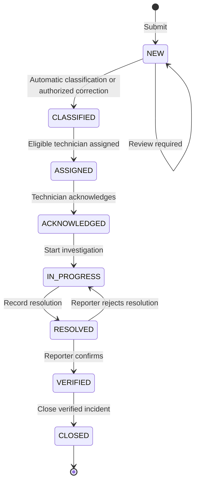

# Application workflows

## Submission and automatic processing

1. A student submits a title, description, category and optional context/template. Suggested urgency is context, not a direct priority override.
2. The backend validates and creates the incident, then matches enabled services with valid criticality against configured keywords in the title/description.
3. Matching normalizes case, Unicode hyphens and Wi-Fi variants. Distinct matching keywords determine score; tied services remain ambiguous. For the combined LAN/Wi-Fi template, unambiguous description evidence can identify the actual network service.
4. Impact and urgency come from configured evidence rules. An unmatched, unambiguous report explicitly categorized Other can use the enabled `OTHER` service and administrator-configured default impact/urgency. Valid fallback criticality is required.
5. Complete, consistent classification enters the saved priority strategy and captures SLA targets/deadlines. Evidence is recorded.
6. Automatic allocation runs immediately. Known services require an active AVAILABLE, skill-qualified technician with spare capacity. General-support fallback selects randomly from active AVAILABLE technicians with capacity without requiring a specialist skill.

Routine incidents require no administrator approval. Notifications do not pause processing. Unknown/tied services, conflicting hints or scope, missing evidence/configuration and disabled automation can require Classification Review. A classified incident with no eligible technician retains priority/SLA while awaiting assignment; the worker can retry it.

## Priority and SLA

Priority configuration currently appears under **Administrator → Assignment Strategies**. The saved strategy can be Weighted, Multiplicative, Matrix or Rule-based. It is not chosen by the student.

Weighted score is `50 × (impactWeight × impact + urgencyWeight × urgency + criticalityWeight × criticality)`, using LOW/MEDIUM/HIGH ordinals 0/1/2 and configured thresholds. Weights are non-negative and sum to 1. Other models use their own configured thresholds, matrix or ordered rules.

The submission's saved response/resolution policies in minutes are P1 **5/30**, P2 **15/130**, P3 **60/500**, P4 **240/1450**. These are editable settings, not universal constants. Existing deadlines are captured snapshots; priority override preserves them.

The frontend displays remaining time from captured timestamps. Server monitoring runs independently of login, normally every five seconds. It records warnings at 80% elapsed and breaches after deadlines. Unacknowledged P1 incidents escalate after the response deadline through Team Lead, System Administrator and IT Manager, with a default five-minute step interval. Administrator manual escalation is separate and audited. Countdown is an SLA target, not a predicted repair duration.

## Technician and administrator actions

The primary technician acknowledges an assigned incident, starts investigation, records notes, requests information and supplies a resolution. The reporter verifies or rejects the resolution. Rejection returns to investigation; verification precedes normal closure.

AVAILABLE permits new automatic allocations; BUSY and UNAVAILABLE exclude them. Existing assignments remain attached when availability changes. Profile and administrator workload views use backend state.

- **Transfer:** a reviewed request changes the primary technician when approved.
- **Collaboration:** approval adds an assisting technician/responsibility while preserving the primary owner.
- **Administrator:** can inspect, assign/reassign, manage collaborators, override priority, escalate and inspect history. Operations enforce eligibility and required reasons.
- **Classification Review:** corrects actual exceptions with an audit reason and continues the existing processing pipeline; it is not routine approval.

## Communication and notifications

Student Conversation is incident-scoped and accessible to the reporter and authorized support participants. Internal Staff Chat is limited to administrators, primary technician and authorized collaborators. Urgent staff instructions are administrator-only. Read positions are persisted per channel. There is no global all-staff broadcast or claimed WebSocket transport.

Notifications persist per recipient with read state, filtering and incident navigation. In-app delivery does not need SMTP. Student email delivery requires a configured sender and uses the persisted outbox.

## Catalog, closure and feedback

Administrators create services with a unique code, name, description, keywords and criticality. Activation requires criticality; enabled configured services appear in Classification Review and matching. Disabled services are excluded.

Withdrawal and invalid/duplicate closure retain records without claiming successful resolution. Normal resolution, verification and closure are distinct transitions. Feedback belongs to the reporting student and incident. Sample feedback in the export is labeled demonstration data.

## Evidence and exception handling

The classifier reads enabled SERVICE entries with valid LOW/MEDIUM/HIGH criticality. It normalizes text with Unicode NFKC, lower case, hyphens and Wi-Fi variants. Distinct configured keyword matches contribute to the score; the unique highest-scoring service wins. It matches both title and description with word boundaries, not a fixed Java service enum. A tie is an exception, not a reason to select the first database row.

Impact and urgency are separate from service recognition. Configured high/medium impact and high/low urgency terms supply evidence. Missing evidence is not silently assigned a guessed level. A single-user scope conflicting with broad-impact text can require review. The combined hostel LAN/Wi-Fi template has a narrowly scoped disambiguation rule using description evidence for CAMPUS_WIFI versus CAMPUS_NETWORK.

For Other/general support, the configured OTHER catalog service and fallback impact/urgency apply only when the fallback conditions are satisfied. Choosing Other alone is not an approval requirement. The fallback still needs enabled service configuration and criticality.

| Observed result | Likely cause | Correct response |
|---|---|---|
| NEW with review flag and pending priority | Tied/no service, conflicting context, incomplete evidence, disabled automation or missing configuration | Read classification notes; correct catalog/rules or perform audited classification |
| CLASSIFIED, priority and SLA present, no technician | No enabled AVAILABLE candidate meeting skill/capacity criteria | Inspect workloads and eligibility; retry after availability/capacity changes |
| Assignment goes to a different technician | Strategy ranks eligible candidates using load/skill rules | Inspect Assignment Preview; do not infer selection from UI order |
| Status still NEW on an old incident after configuration changes | Editing settings is not a blanket historical reprocessing command | Use the supported incident action; do not rewrite records directly |

## Allocation policies

[AssignmentService.java](../bits-itsm/backend/src/main/java/com/bits/itsm/assignment/AssignmentService.java) filters eligibility before applying a strategy. [Technician.java](../bits-itsm/backend/src/main/java/com/bits/itsm/user/Technician.java) requires enabled status, AVAILABLE and workload below capacity. Known categories additionally require the configured skill. Skill-based selection ranks preferred skill and weighted workload with ID tie-breaking; load-based selection ranks weighted workload while retaining the skill filter. General support uses RandomAvailableAssignment without specialist matching. Random selection is not a guarantee of equal distribution in a small sample.

Settings and incident locks coordinate assignment-sensitive updates. Automatic attempts occur during creation and through retry processing. Administrator notifications do not pause them. Availability changes preserve existing ownership; a transfer is a separate audited operation. BUSY does not mean available for another automatic assignment.

## Lifecycle and responsibilities

This shows the normal lifecycle, not every authorized exceptional transition. `Needs Review` and pending assignment are flags/conditions, not additional enum states. Reassignment/collaboration and information requests have their own rules and do not introduce a `WAITING` enum status. Withdrawal or invalid/duplicate disposition can close eligible non-resolved reports without a successful resolution; history is retained.

The Start Work API accepts an ASSIGNED incident by acknowledging it and starting investigation in the same service operation; the entity start transition itself requires ACKNOWLEDGED. Collaborators can contribute notes, but the primary technician owns lifecycle actions. Information requests set an awaiting-student flag; they do not introduce a WAITING enum or pause SLA deadlines.

A resolution records summary and steps. The reporter confirms it to reach VERIFIED or rejects it with a reason to resume IN_PROGRESS. Rejection clears the current resolution fields but preserves history. Administrator normal closure follows verification. Feedback is a reporter-owned rating from 1 to 5 with optional comment and lifecycle checks.

Withdrawal means withdrawing a NEW incident, not deleting an account. Invalid/duplicate closures are administrator dispositions, require reasons and retain history. User disabling is a separate administrator action; unresolved assignments must be reassigned before a technician account can be disabled.

## Transfers, collaborators and messaging

A transfer request proposes a technician and handover reason. Administrator approval revalidates the destination and changes the primary owner; rejection/cancellation records the decision. Collaboration adds a qualified supporting technician with an explicit responsibility and leaves the primary owner intact. Request review can adjust the proposed technician through the existing review DTO. Direct administrator team changes are also audited.

Student conversation is shared with the reporter and authorized support participants. Internal chat is incident-scoped: administrators, the primary technician and approved collaborators, not all staff. Only administrators send urgent staff instructions. Both channels persist read positions independently. Polling retrieves later messages; there is no claim of instantaneous delivery.

## Priority models and captured SLA

The export selects MATRIX. Weighted and multiplicative modes use configured thresholds; matrix mode uses nine impact/urgency cells plus criticality adjustment; rule-based mode uses ordered configured rules and a fallback priority. Students supply context, never a final priority. The API preview calculates a proposed configuration without persisting it.

SLA policies are editable, so saved export values differ from initial defaults. Deadlines/targets are captured for incidents rather than continually recalculated from the current policy. Priority overrides preserve deadlines and require an audit reason. Monitoring warns at 80% elapsed and records breaches after the deadline. Automatic escalating levels apply to unacknowledged P1 incidents; they are not an automatic reassignment workflow or separate login roles.

## Similarity, estimates and analytics

DuplicateDetector compares open, same-service candidates within its time/category criteria using text similarity and a threshold. Related reports are suggestions; the system does not merge or delete them automatically. HistoricalResolution requires enough comparable successful resolutions, excludes withdrawn/invalid/duplicate closures, and returns a rounded median duration from a bounded recent sample. It is distinct from the contractual SLA.

Dashboard totals come from authorized incident lists and management APIs. Averages with no eligible records are unavailable rather than fabricated zero-success results. The export contains demonstration feedback and historical dates, not a measured production satisfaction study.

Source entry points: [IncidentService.java](../bits-itsm/backend/src/main/java/com/bits/itsm/incident/IncidentService.java), [IncidentClassificationService.java](../bits-itsm/backend/src/main/java/com/bits/itsm/classification/IncidentClassificationService.java), [AssignmentService.java](../bits-itsm/backend/src/main/java/com/bits/itsm/assignment/AssignmentService.java), [HistoricalResolution.java](../bits-itsm/backend/src/main/java/com/bits/itsm/incident/HistoricalResolution.java), [DuplicateDetector.java](../bits-itsm/backend/src/main/java/com/bits/itsm/intelligence/DuplicateDetector.java).
