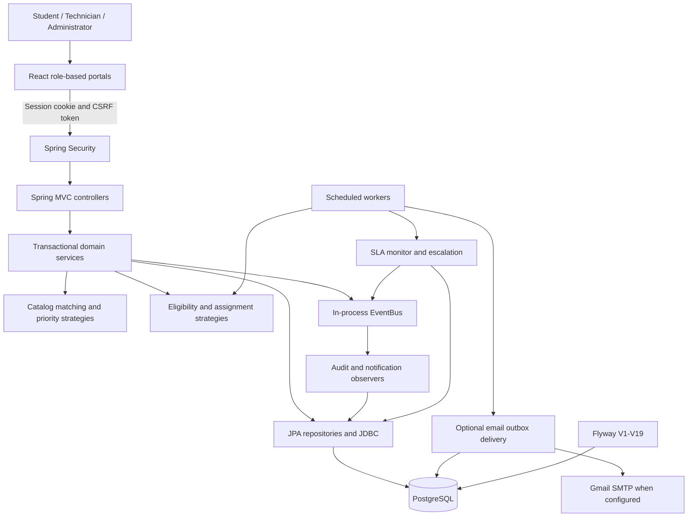
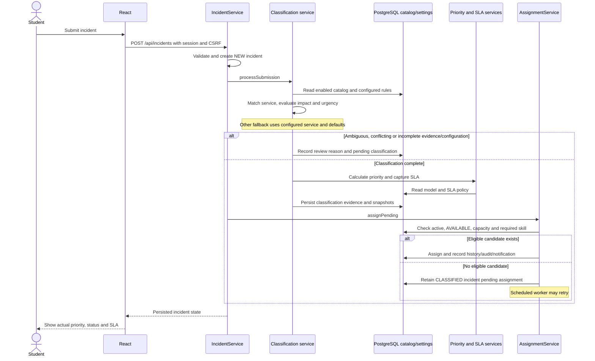

# Architecture

BITSolve is a three-tier modular application: React presents role-specific workflows, a Spring Boot process enforces policy, and PostgreSQL persists records. It is not a microservice system, a machine-learning classifier or a broker-based event platform.

| Layer | Implementation | Boundary |
|---|---|---|
| Presentation | React 19.3 / Vite 8.3 | Forms, navigation, accessible controls, API state and countdowns |
| HTTP | Spring MVC and Security | JSON contracts, session identity, CSRF and role checks |
| Application | Java 25 services | Transactions, participant permissions, workflow orchestration |
| Domain | Incident, User hierarchy, strategies | State invariants and replaceable policies |
| Persistence | Spring Data JPA / Hibernate; selected JDBC | Queries, row locks, durable settings and history |
| Storage | PostgreSQL 18 / Flyway V1–V19 | Constraints, relationships, migration history |

The executable JAR serves the built frontend and API together. Development uses Vite with an API proxy. EventBus is in-process, not Kafka/RabbitMQ. Workers run while the backend is running; no user login is required.

## Request path and deployment

[IncidentController.java](../bits-itsm/backend/src/main/java/com/bits/itsm/incident/IncidentController.java) accepts validated DTOs from [api.js](../bits-itsm/frontend/src/api.js). [IncidentService.java](../bits-itsm/backend/src/main/java/com/bits/itsm/incident/IncidentService.java) resolves the signed-in user, checks ownership/role, locks records where required, invokes domain operations and returns a filtered view. Repositories operate within the service transaction. Students do not receive private investigation notes or staff-channel messages.

The production Maven build copies the already-built frontend distribution into the executable JAR. Spring serves the SPA and /api on port 8080. Vite development runs on 5173 and proxies /api to 8080. The Dockerfile builds React, builds Java with tests skipped, and runs a Java 25 JRE as UID 10001. It does not start PostgreSQL or restore the SQL export. An external PostgreSQL connection is required.

## Authentication and trust boundaries

[SecurityConfig.java](../bits-itsm/backend/src/main/java/com/bits/itsm/auth/SecurityConfig.java) uses HTTP sessions rather than bearer JWTs. Login authenticates JSON credentials, changes the session ID and rotates CSRF state. Cookies are HTTP-only, SameSite=Lax; default session timeout is 30 minutes. The prod profile enables secure cookies by default. HTTPS termination and trusted proxy configuration remain deployment responsibilities.

Public registration creates a student regardless of client-supplied role. The institutional email restriction checks address format/domain; it does **not** prove ownership of the mailbox. BCrypt cost 12 is configured for newly encoded application passwords. Exported demo hashes may use a different cost and are not evidence of production credentials.

URL role checks protect administrator/student/technician namespaces. Shared incident routes also enforce record-level ownership and team access in services. Disabled-account and credential-version checks invalidate access on later requests. Hiding a UI action is not authorization.

## Domain modules

| Module | Principal source | Responsibility |
|---|---|---|
| Incident lifecycle | [IncidentService.java](../bits-itsm/backend/src/main/java/com/bits/itsm/incident/IncidentService.java) | Creation, transitions, resolution, verification, closure |
| Service catalog | [CatalogService.java](../bits-itsm/backend/src/main/java/com/bits/itsm/incident/CatalogService.java) | Enabled services/categories, criticality and keywords |
| Classification | [IncidentClassificationService.java](../bits-itsm/backend/src/main/java/com/bits/itsm/classification/IncidentClassificationService.java) | Keyword evidence, ambiguity, configured fallback |
| Priority | [PriorityService.java](../bits-itsm/backend/src/main/java/com/bits/itsm/priority/PriorityService.java) | Select saved calculation strategy |
| Allocation | [AssignmentService.java](../bits-itsm/backend/src/main/java/com/bits/itsm/assignment/AssignmentService.java) | Eligibility, capacity, primary owner and team changes |
| SLA | [SlaMonitor.java](../bits-itsm/backend/src/main/java/com/bits/itsm/sla/SlaMonitor.java) | Deadline monitoring independent of login |
| Conversations | [IncidentConversation.java](../bits-itsm/backend/src/main/java/com/bits/itsm/incident/IncidentConversation.java) | Separate student and internal staff channels |
| Recovery | [PasswordRecovery.java](../bits-itsm/backend/src/main/java/com/bits/itsm/auth/PasswordRecovery.java) | Administrator-issued reset codes and password change |

## Events, transactions and scheduled workers

[EventBus.java](../bits-itsm/backend/src/main/java/com/bits/itsm/event/EventBus.java) receives a list of IncidentObserver beans through constructor injection. Dispatch is synchronous: all observers are attempted and a captured exception is propagated afterward. A surrounding database transaction can roll back; this is not an independently durable event broker. Audit and recipient notification records are database-backed.

[EmailChannel.java](../bits-itsm/backend/src/main/java/com/bits/itsm/notification/EmailChannel.java) persists selected student email events in an outbox. The mail worker reads committed deliveries and retries failed sends, with a maximum of three attempts. SMTP is optional; in-app notifications do not depend on it. Actual delivery was not verified for submission.

Assignment retry and SLA workers run in the backend process without a logged-in user. Scheduled-event keys suppress duplicate warnings/escalations across restarts. They do not provide general exactly-once external email delivery. Server downtime delays monitoring until the process resumes.

No administrator approval occurs in the successful automatic path. General-support fallback uses random available allocation without a specialist skill requirement. Missing technicians do not erase classification or SLA results.

## Scope and limitations

All configuration and transitions are implemented in one application/database boundary. Keyword matching depends on administrator-maintained evidence and cannot understand arbitrary natural language. Notification updates use polling rather than WebSockets. Deadline countdowns are service targets; a separate historical estimate is only available with enough comparable successful resolutions. See [workflows](WORKFLOWS.md), [database](DATABASE.md), [API contracts](API_REFERENCE.md) and [verification](VERIFICATION.md).
