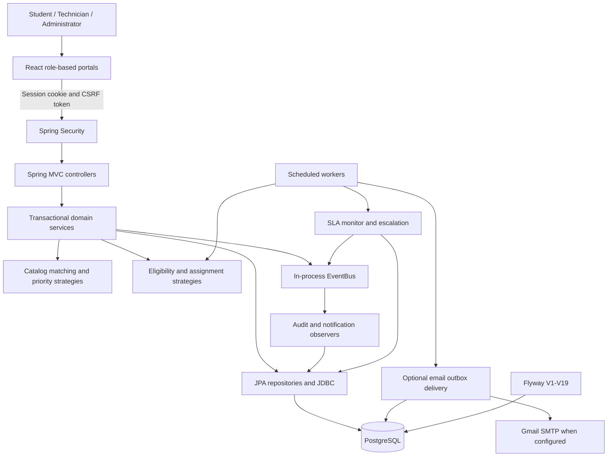

# System architecture

The executable JAR serves the built frontend and API together. Development uses Vite with an API proxy. EventBus is in-process, not Kafka/RabbitMQ. Workers run while the backend is running; no user login is required.
