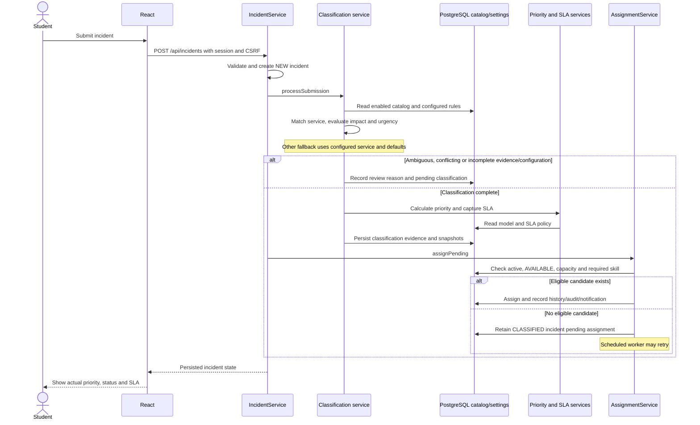

# Automatic incident processing

No administrator approval occurs in the successful automatic path. General-support fallback uses random available allocation without a specialist skill requirement. Missing technicians do not erase classification or SLA results.
