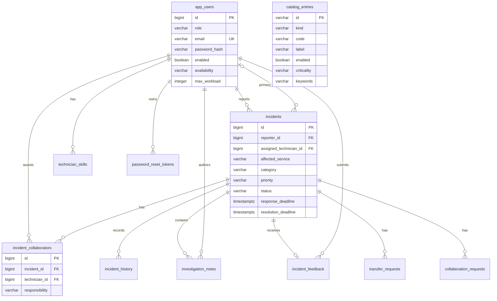

# Core database relationships

Selected core relationships only. Transfer/collaboration records also reference requesting, proposed and reviewing users. `catalog_entries` is intentionally separate: incident service/category codes are logical references, not physical foreign keys to its ID. Configuration, notification, read-receipt, audit, scheduled-event and Flyway tables are described in [Database](../database.md); not every stored identifier is a foreign key.
