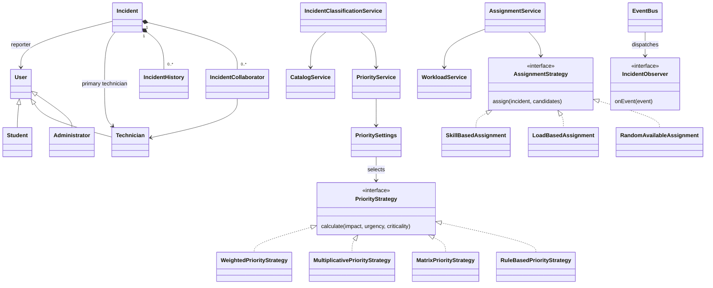

# Domain and strategy classes

Selected design relationships. Service dependencies are not database tables. Dynamic catalog code value objects and transport DTOs are omitted for readability; see [OOP design](../object-oriented-design.md).
