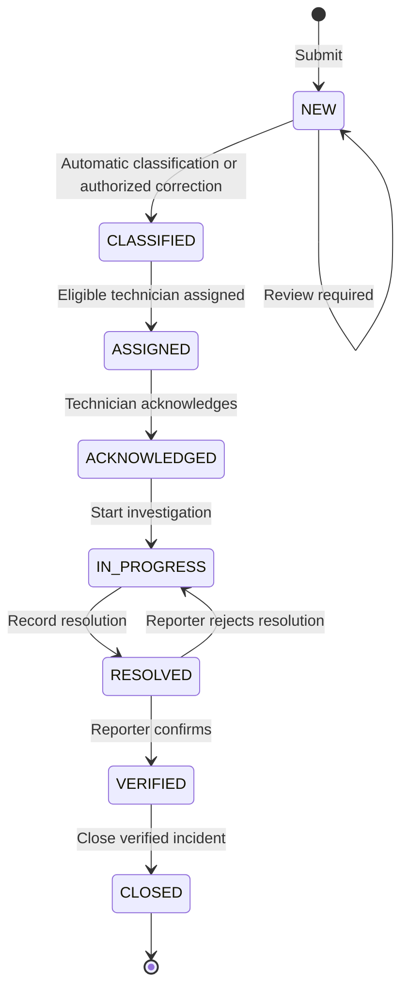

# Incident lifecycle

This shows the normal lifecycle, not every authorized exceptional transition. `Needs Review` and pending assignment are flags/conditions, not additional enum states. Reassignment/collaboration and information requests have their own rules and do not introduce a `WAITING` enum status. Withdrawal or invalid/duplicate disposition can close eligible non-resolved reports without a successful resolution; history is retained.
